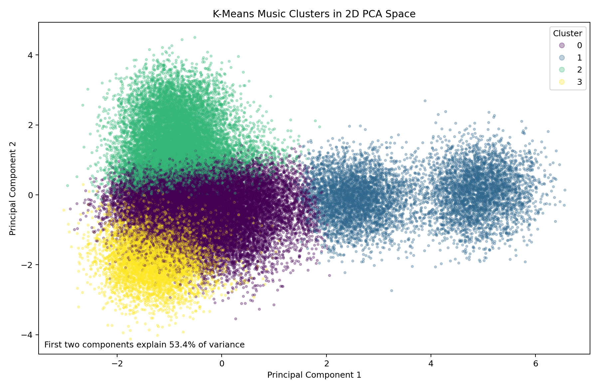
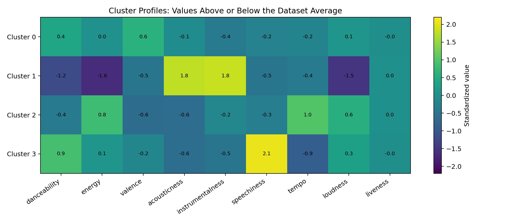

# Smart Playlist Agent

A Python music recommendation project that uses K-Means clustering to select tracks for different listening contexts. Developed as an Artificial Intelligence course project.

## Features

- Four listening modes: **Focus / Study**, **Workout**, **Feel-Good**, and **Rhythm / Urban**.
- Clustering based on nine audio features with StandardScaler preprocessing.
- Recommendations ranked by distance to a target listening profile.
- Optional filtering of explicit tracks.
- Automatic charts, cluster summaries, sample recommendations, and model export.

## How it works

1. Load the CSV and remove rows with missing audio features.
2. Standardize danceability, energy, valence, acousticness, instrumentalness, speechiness, tempo, loudness, and liveness.
3. Fit a K-Means model with four clusters (`n_init=20`, `random_state=42`).
4. Match each predefined listening profile to its nearest cluster center.
5. Rank tracks within that cluster by Euclidean distance to the profile.

The application works locally with a CSV file. It does not connect to a Spotify account, play audio, or create playlists in Spotify.

## Getting started

Use Python 3.10 or newer. From the project directory:

```bash
python -m venv .venv
```

Activate the environment on Windows PowerShell:

```powershell
.\.venv\Scripts\Activate.ps1
```

Or on macOS / Linux:

```bash
source .venv/bin/activate
```

Install dependencies and run:

```bash
python -m pip install -r requirements.txt
python smart_playlist_agent.py --mode workout --count 10
```

Each run trains the model and generates the analysis outputs before printing recommendations. The elbow analysis fits additional models and may take some time.

## Usage examples

```bash
python smart_playlist_agent.py --mode focus --count 10 --no-explicit
python smart_playlist_agent.py --mode feelgood --count 10
python smart_playlist_agent.py --mode rhythm --count 10
python smart_playlist_agent.py --csv spotify_tracks.csv --output outputs --mode workout --count 15
```

Use `python smart_playlist_agent.py --help` to view the command-line options.

## Example results

The original project run recorded **50,000 tracks**, a **0.202 silhouette score** on a 2,500-track sample, and **53.4% explained variance** in the first two PCA components. These are clustering diagnostics, not recommendation accuracy measurements. The original results are preserved in [examples/results_summary.txt](examples/results_summary.txt).

### Cluster visualization



### Audio feature profiles



See [sample recommendations](examples/sample_recommendations.csv) and [cluster statistics](examples/cluster_summary.csv).

## Project files

```text
smart-playlist-agent/
|-- smart_playlist_agent.py
|-- requirements.txt
|-- spotify_tracks.csv
|-- docs/images/
|-- examples/
|-- .gitignore
`-- README.md
```

Running the program creates `outputs/` with correlation, elbow, PCA, cluster profile, and cluster size charts; CSV summaries; a text report; and a saved model bundle. Generated outputs are excluded from version control.

## Dataset

The supplied CSV contains 50,000 rows and 21 columns. The original course documentation describes it as a synthetic educational dataset and credits **Lorenzo Scaturchio, Spotify Tracks: Audio Features (50K Songs), Kaggle (2026)**. This attribution is retained from the original project; the original source URL and dataset license have not been independently verified.

The data represents Spotify-style audio features. Results on this educational dataset should not be interpreted as validated recommendations for real Spotify users.

## Limitations

- Listening profiles and the number of clusters are predefined.
- Recommendations do not adapt to user feedback or listening history.
- Cluster quality does not establish user satisfaction.
- The model is retrained on each run; the exported model is not loaded by the current command-line interface.

## Technologies

Python, pandas, NumPy, scikit-learn, Matplotlib, and joblib.
